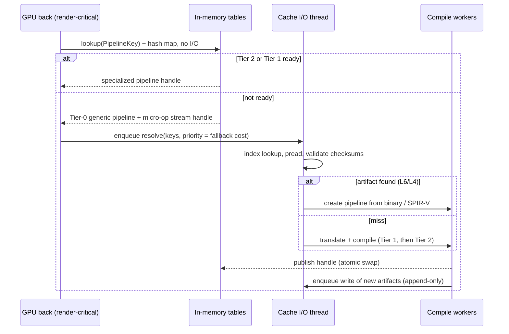

# 02 — Cache Architecture Proposal

Status: Proposed (highest-priority deliverable) · Related ADRs: 0014, 0015, 0016, 0013 · Validating PoC: PoC-6, PoC-1

## 1. Principles

1. **The cache is an optimization, never a prerequisite.** Every artifact can be regenerated
   from guest data. An empty, missing, corrupt or incompatible cache produces a correct game.
2. **O(1) startup.** Opening a cache reads a bounded amount of data, whatever the cache size.
3. **No disk I/O on render-critical threads.** Not `read`, not `write`, not `fsync`, not an
   `mmap` page fault. Render threads only consult in-memory tables and enqueue requests.
4. **Content addressing.** Artifacts are identified by hashes of their inputs. There is no
   "update" of an artifact, so there are no update anomalies and no migrations.
5. **Never trust stored bytes.** Every record is framed and checksummed; failed validation is a
   cache miss, never an error that stops the game.
6. **Layer by portability.** Guest-derived artifacts survive emulator and driver updates;
   host-derived artifacts are scoped to the translator version; driver artifacts are scoped
   to the exact driver identity.

## 2. Artifact layers

| Layer | Artifact | Key | Portable across | Persisted? | Typical size |
|-------|----------|-----|-----------------|------------|--------------|
| L0 | Guest program image (SPH header + reachable code) | `GuestProgramId` | Everything | Yes | 1–200 KiB |
| L1 | Dependency schema (which guest state the translator read) | `GuestProgramId` + `translator_epoch` | Drivers | Yes | < 1 KiB |
| L2 | Tier-0 micro-op stream (interpreter input) | `GuestProgramId` + `interp_format` | Drivers | Optional (PoC decides: regenerate vs read) | ~1.5× L0 |
| L3 | Lince IR (optimized) | — | — | **No** (in-memory only; re-derive) | — |
| L4 | Host shader per tier and backend (SPIR-V for Vulkan) | `HostShaderKey` | Drivers of the same backend with same feature profile | Yes | 2–500 KiB |
| L5 | Pipeline description (stage keys + normalized fixed-function state + layout) | `PipelineKey` | Drivers of the same backend with same capability tier | Yes | < 512 B |
| L6 | Driver binaries (`VK_KHR_pipeline_binary` or sharded `VkPipelineCache`) | `PipelineKey` within a `DriverIdentity` namespace | Nothing | Yes | 10 KiB–2 MiB |
| L7 | Session profile (usage, measured costs, co-occurrence) | `title` + session | Drivers | Yes, bounded ring | ≤ 1 MiB |
| L8 | Boot manifest (prefetch hint list) | `title` | Drivers | Yes | ≤ 64 KiB |

Global (game-independent) artifacts — the Tier-0 interpreter pipelines and utility shaders —
live in a `_global` namespace keyed by `DriverIdentity`. They are compiled once per driver,
never per game (doc 03 §4.6).

## 3. Identity and keys

All keys are 128-bit XXH3 hashes over a canonical, versioned byte encoding. Cryptographic
hashing is not needed for a local cache; shared caches (out of scope) would add BLAKE3
signatures.

```text
GuestProgramId = H("LNX/prog/v1", stage, sph_header, reachable_code_bytes)
DependencyKey  = H(GuestProgramId, translator_epoch, [(location, value) for each dependency])
HostShaderKey  = H(DependencyKey | GuestProgramId, tier, translator_version, backend, host_feature_profile)
PipelineKey    = H(backend, capability_tier, [HostShaderKey per stage], normalized_static_state, layout_id)
DriverIdentity = H(backend, vendor_id, device_id, driver_version, pipeline_cache_uuid, api_version)
```

- **`backend`** identifies the host graphics API (Vulkan first; Direct3D 12 and Metal later,
  ADR-0006). It is part of every host-derived key from the start so a second backend never
  needs a cache format change; L0–L2 stay backend-independent.
- **`reachable_code_bytes`**: SASS has no length field; extent comes from a control-flow scan
  of the program (fast linear decode). The GPU memory tracker caches `address → GuestProgramId`
  and invalidates on writes to those pages, so the scan and hash happen once per upload, not
  per draw.
- **Dependencies** are recorded by the translator, not guessed (ADR-0009). Example entries:
  `cbuf[3][0x40]` (indirect branch table base), `texture_type(handle)`, `viewport_transform`.
  Tier-1 shaders turn most dependencies into runtime parameters so one host shader serves all
  states (doc 03 §4.2); only Tier-2 bakes them in.
- **`normalized_static_state`** contains only state that is *not* dynamic on the active
  capability tier. The more dynamic state the host supports, the fewer pipeline keys exist.
- **`translator_version`** is bumped per pass that changes output semantics. Old L4–L6 entries
  simply stop matching; nothing is migrated.

## 4. On-disk layout

```text
<cache_root>/
  _global/<DriverIdentity>/...          # interpreter pipelines, utility shaders
  <title_id>/
    store.lock                          # advisory lock: one writer process
    MANIFEST                            # ≤ 4 KiB: format, generation, index file, segment table
    index.<gen>                         # memory-mapped open-addressing hash table
    seg/000001.lseg ...                 # append-only segments, sealed at 64 MiB
    driver/<DriverIdentity>/            # same store format, driver-scoped namespace (L6)
    profile/ring-<n>.lprof              # last K session profiles (L7)
    boot.lman                           # boot manifest (L8)
```

### 4.1 Segment record framing

```text
offset  size  field
0       4     magic "LNXR"
4       2     kind (L0..L8 artifact kind; unknown kinds are skipped, not errors)
6       1     codec (0 = raw, 1 = lz4)
7       1     flags (bit 0: tombstone)
8       4     stored_len
12      4     raw_len
16      16    key (u128)
32      4     header CRC-32C over bytes 0..32
36      4     reserved (0)
40      8     XXH3-64 of payload, seeded with kind and key
48      ...   payload, then zero padding to 16-byte alignment
```

A torn tail (crash mid-append) fails the header CRC and is ignored; the next append pads to the
following aligned boundary. Segments are immutable once sealed.

### 4.2 Index

- Power-of-two bucket count, linear probing, load factor ≤ 0.7.
- 32-byte entries: `key u128 · segment u32 · offset u32 (×16 bytes) · len u32 · kind u8 ·
  flags u8 · entry_check u16`.
- A lookup touches one or two cache lines of a memory-mapped file — no deserialization.
- Only the writer thread mutates the file. Same-process readers check a small in-memory
  overlay of recent inserts first, then the mapped table. `entry_check` detects torn entries.
- **Growth:** when the load factor is exceeded, the writer builds `index.<gen+1>` at twice the
  size in the background, then commits a new `MANIFEST` with write-temp → fsync → rename.
  Readers remap on the generation change (on the resolver thread).

## 5. Startup sequence (answer to "how a game starts without loading the cache")

| Step | Thread | Work | Bound |
|------|--------|------|-------|
| 1 | Cache I/O | Open `store.lock` (try once; on failure become read-only) | 1 syscall |
| 2 | Cache I/O | Read and validate `MANIFEST` | ≤ 4 KiB |
| 3 | Cache I/O | `mmap` the index (no read; pages fault in later on this thread only) | O(1) |
| 4 | Cache I/O | Read `boot.lman` and hand its keys to the scheduler as **P2 prefetch** work | ≤ 64 KiB |
| 5 | Cache I/O | Schedule a background tail scan of the newest segment beyond the manifest's indexed high-water mark | runs after boot |

The game's first guest instruction does **not** wait for steps 4–5. If any step fails, the
title runs with an empty in-memory overlay and a background rebuild is queued.

**Startup budget (proposed, to be confirmed by PoC-6):** steps 1–3 ≤ 10 ms at the 99th
percentile on an NVMe SSD, with a difference of ≤ 2 ms between a 1 MiB and a 4 GiB cache.

## 6. Runtime resolution (answers "unknown shader without waiting" and "invisible to rendering")



- Publication is a single atomic pointer swap per pipeline slot. The next draw that consults
  the slot uses the faster tier. No frame waits for publication.
- A Tier-0 micro-op stream for a newly seen program is produced by a linear pre-decoder. Its
  cost on the render-critical path is the open measurement of PoC-2; the design target is that
  discovery-time compilation (doc 03 §5) moves it off that path for most programs.
- Resolve requests are deduplicated per key; cancelled when the key is evicted from the
  in-memory tables before being serviced (obsolete speculative work).

## 7. Write path

- Writes are queued from any thread to a single **cache writer** per store (bounded queue;
  when full, low-priority artifacts are dropped — losing a cache write is always safe).
- The writer appends records, batches `fdatasync` (low I/O priority), then inserts index
  entries. If the process dies in between, the index may point to unsynced bytes: those fail
  validation on read and become misses.
- The writer stops issuing I/O while the frame governor reports deadline pressure (ADR-0018),
  except for flushing on shutdown.

## 8. Invalidation and versioning

| Change | Effect |
|--------|--------|
| Game update (new code) | New `GuestProgramId`s; old ones age out by LRU. |
| Emulator translator change | `translator_version` bump: L4/L5 for new keys; old entries age out. |
| Emulator format change | New `MANIFEST` format → title store renamed to `.old` and deleted in background; start empty. No migration code ever runs at boot. |
| Driver update | New `DriverIdentity` namespace; old namespace deleted after N days unused. |
| Capability tier change (different GPU) | Different `PipelineKey`s; L0/L1/L4 still reused. |

## 9. Corruption recovery

| Failure | Detection | Response |
|---------|-----------|----------|
| Torn record | Header CRC | Skip; pad next append |
| Corrupt payload | XXH3 mismatch on read | Miss; index entry tombstoned; regenerate |
| Corrupt index | Header CRC or impossible entries | Start with empty overlay; background rebuild from segments |
| Corrupt `MANIFEST` | CRC | Previous generation if valid, else start empty |
| Driver rejects a binary | `VK_ERROR_*` on creation | Drop L6 entry; rebuild from L4 |
| Crash during previous boot's prefetch | Marker file left behind | Skip prefetch this boot |

None of these paths blocks game start.

## 10. Concurrency

- One writer **process** per title store (advisory lock). A second emulator instance opens the
  store read-only and keeps new artifacts in memory.
- One writer **thread** per store inside the process. Readers are lock-free on the mapped
  index; the overlay is a sharded concurrent map.
- Render-critical threads never take a lock owned by cache threads.

## 11. Eviction and compaction

- Per-title budget (default proposal: 2 GiB; driver namespace 512 MiB), configurable.
- Eviction order: L6 of other drivers → L4/L5 not used in the last K sessions → L2 → L0 of
  programs not seen in M sessions. L0 is evicted last: it is small and needed to rebuild.
- Compaction rewrites live records into new segments when the garbage ratio exceeds 30%.
  It runs only at low I/O priority, only when the governor reports headroom, and in bounded
  chunks (e.g. ≤ 8 MiB per slice) so it can pause between frames.

## 12. Driver layer (L6)

- Preferred: `VK_KHR_pipeline_binary` — one record per pipeline, loaded lazily.
- Fallback: **sharded** `VkPipelineCache` objects (one per ~256 pipelines), each loaded lazily
  by the resolver when one of its keys is requested. Never one monolithic blob at boot.
- Last resort: no driver layer; rely on the driver's internal cache.
- With `VK_EXT_pipeline_creation_cache_control`, a resolver first tries creation with
  `FAIL_ON_PIPELINE_COMPILE_REQUIRED` to detect a driver-cache hit without compiling.

## 13. Predictive layer (warm-cache bonus, never required)

- **Session profile (L7):** which pipelines were used, when (relative to scene markers), their
  measured Tier-0 GPU cost and compile times, and co-occurrence clusters.
- **Boot manifest (L8):** up to 4,096 pipeline keys most likely needed in the first minutes,
  ranked by `P(use) × fallback_cost`. Prefetched at P2 after boot.
- **Scene clusters:** when the first pipeline of a known cluster is requested, the remainder of
  the cluster is queued at P2. This is how a warm cache improves revisits without a warm-up.

## 14. The five explicit answers

1. **Game starts without loading the cache** — §5: manifest + mmap + bounded hint list; no
   record is read before the first guest instruction.
2. **Unknown shader runs without waiting** — §6 and doc 03: Tier-0 generic execution from a
   micro-op stream; compilation happens off the critical path.
3. **Specialized pipelines in the background** — §6: resolver → compile workers → atomic
   publish, prioritized by measured fallback cost and governed by ADR-0018.
4. **Cache operations invisible to rendering** — principle 3: render threads touch only
   in-memory tables; I/O, validation and compaction run on dedicated, governed threads.
5. **Cache size affects neither startup nor gameplay** — §4–§5: O(1) open, O(1) lookup,
   append-only writes, background growth/compaction with generation swaps.

## 15. Measurements (feed doc 05)

`cache.open_ms`, `cache.lookup_ns` (render tables), `cache.resolve_us` (index + read +
validate), `cache.hit_ratio{layer}`, `cache.write_queue_depth`, `cache.fsync_ms`,
`cache.compaction_ms_per_slice`, `cache.bytes{layer}`, `cache.validation_failures`.

## 16. Open questions → PoC-6

- Custom store vs. `redb` vs. SQLite (WAL) under the same workload (ADR-0015).
- Whether persisting L2 micro-op streams beats regenerating them.
- Index page-fault latency on the resolver thread with cold OS page cache (HDD and NVMe).
- lz4 vs. no compression for SPIR-V given read latency targets.
